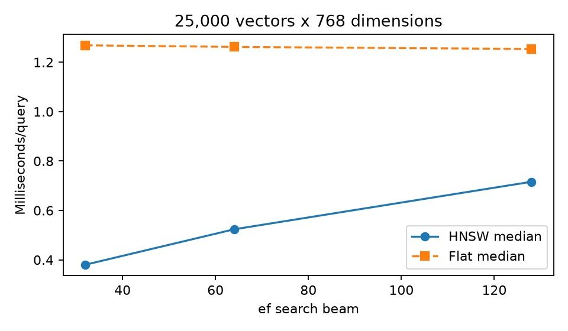

# Mission 05: Dual-Path Associative Memory
## HNSW, hybrid search and source-grounding audit

Conversational AI | BTU WS 2026/27 | Squadron Fei-Fei (Group 13)

7 November 2026

**Repository:** [bilal-younus/aura-fei-fei](https://github.com/bilal-younus/aura-fei-fei)

**Code:** [Mission Five](https://github.com/bilal-younus/aura-fei-fei/tree/main/Mission%20Five)

## Team roles

| Member | Station | Scope |
|---|---|---|
| Bilal Younus | Systems Architect | HNSW layers, cosine traversal and latency benchmark |
| Danish Hafeez | Communications & Protocol Officer | BM25, exact identifiers and RRF |
| Anas Arshad | Data & Payload Specialist | NotebookLM citation, refusal and audio audit |
| Shahzaib Ahmed | Security & Ethics Sentinel | Injection defence, RAG Triad and provenance |

## Architecture

Query -> MiniLM dense embedding -> NumPy HNSW candidates; the same query -> exact-preserving tokenizer -> BM25 candidates. One-based reciprocal ranks merge both paths with k=60. Retrieved chunks pass heuristic and embedding-based injection checks before an extractive answer is assembled. The trace records source IDs, scores, quarantines and supported answer sentences. An auxiliary entity graph expands local evidence and exposes extractive community summaries.

The dense retrieval demonstration uses real pretrained 384-dimensional MiniLM embeddings. The separate indexing benchmark uses 25,000 synthetic 768-dimensional vectors, as required. Synthetic ship serial numbers are labelled fixtures, not course specifications. External NotebookLM results are preserved observations, not Python-simulated service outputs.

<!-- pagebreak -->

# 1. HNSW indexing and hybrid retrieval

Vectors are L2-normalized, making cosine similarity a dot product. Levels follow floor(-ln(U)/ln(M)) with seeded U in (0,1). Insertion descends greedily through upper layers, performs ef-bounded heap search at lower layers, links neighbors and prunes degree. Base degree is bounded by 2M and upper degree by M. Nearest-neighbor pruning is a simplified alternative to the original diversity heuristic; it can reduce recall.

The full benchmark uses N=25,000, dimension=768, M=12, efConstruction=32 and 40 independent held-out queries from 64 synthetic Gaussian clusters. Both search paths use one numerical-library thread, warm-up, identical normalized vectors and cosine distance. Flat timing includes top-10 selection. HNSW timing includes traversal and top-10 output, but neither includes model embedding time.

| ef | HNSW median ms | Flat median ms | Recall@10 | Mean distance evaluations |
|---|---|---|---|---|
| 32 | 0.380 | 1.268 | 0.573 | 338.5 |
| 64 | 0.524 | 1.262 | 0.632 | 416.3 |
| 128 | 0.716 | 1.253 | 0.668 | 579.9 |

Build time was 8.61 seconds. The layer populations were [25000, 2033, 173, 12, 2]. Vector storage alone is 76.8 MB; graph and Python overhead are additional. Sub-millisecond medians come with missed neighbors. A single dataset size does not prove logarithmic scaling or guarantee latency on other distributions.

<!-- pagebreak -->

# 2. BM25, fusion and graph assistance

BM25 uses k1=1.5, b=0.75 and log(1+(N-df+0.5)/(df+0.5)) IDF. Tokenization preserves hyphenated serial identifiers. RRF sums 1/(60+rank) for each distinct candidate; rank starts at one and absent documents contribute zero. Raw dense and sparse scores are never added directly.

| Query | Dense top-1 | BM25 top-1 | Fused top-1 |
|---|---|---|---|
| concept_memory | semantic_memory | semantic_memory | semantic_memory |
| concept_global | graph_global | graph_global | graph_global |
| exact_serial | ship_cooling_near | ship_cooling | ship_cooling |
| exact_sensor | ship_spares | ship_sensor | ship_sensor |
| mixed | ship_power | ship_power | ship_power |

Dense search retrieves semantically related memory and global-summary chunks. It confuses the neighboring XQ serials and misses the exact sensor as its first result; BM25 and fusion return the correct identifiers. Fusion succeeds at top-1 on all five curated examples. This small demonstration does not establish a general win rate; at rank three, fusion can displace a relevant conceptual result with a high lexical candidate.

The auxiliary graph connects 22 chunks by explicit shared-entity labels and partitions them with Louvain. Beryl expands cooling evidence to its power controller and sensor. Summaries are extractive. This is transparent graph-assisted retrieval, not a claim to reproduce Edge et al.'s LLM extraction, Leiden hierarchy or generative map-reduce pipeline.

# 3. Injection defence and RAG Triad

The detector canonicalizes Unicode, removes zero-width formatting, recognizes role delimiters, overrides and remote image tags, and compares chunk embeddings with directive prototypes. It quarantines a whole suspect chunk rather than editing it into apparently trustworthy evidence. No remote image or extracted URL is fetched.

All six adversarial fixtures were quarantined; all four benign fixtures passed. These are narrow, disclosed fixtures, not a universal security guarantee. Quoted security discussions can trigger false positives; obfuscated novel attacks can evade prototypes.

Context relevance is the fraction of retrieved sentences above a cosine threshold. Faithfulness is the fraction of answer claims with normalized exact-text support in the surviving context. Answer relevance is query cosine similarity to the mean normalized claim embedding. These are transparent proxies, not an entailment judge or factual-truth oracle. Refusals with no claims have null faithfulness rather than a misleading perfect score.

The provenance JSONL records every query, chunk ID, dense/sparse/RRF score, scan result, cited IDs and final answer. The known cooling fixture returns 480 hours; the nonexistent chroniton code is refused. Source copying can preserve a false source assertion, so source authority remains separate from textual support.

<!-- pagebreak -->

# 4. NotebookLM empirical grounding lab

Lewis et al. and Edge et al. were uploaded as research PDFs. The course website's Week 5 lore and mission tabs, and the official repository, were checked for the separately named technical archive. It was not found. Document C is an explicit summary replacement based on the public course website, not an invented official archive. Its original text and provenance are included.

Five cross-document questions compare memory, retrieval granularity, index updates, global summaries and grounding. All ten technical sentences have badges, but the strict displayed-span audit yields 52.94% (9/17) citation precision. All badge occurrences were opened. A partial span is counted as unsupported under the declared whole-sentence rule, even if another badge supplies complementary evidence. The detailed audit preserves all judgments and unedited service responses.

Three absent-fact probes asked for a fictitious ignition code, a fictitious model's MMLU score and an unsupported coolant temperature. All three explicitly acknowledged that the requested fact was absent. This is evidence about those probes only.

## Audio Overview status

The generated Deep Dive was titled "How RAG and GraphRAG Stop AI Hallucinations" and lasted about 22:51. The audited excerpt is 00:00-02:00; its recording and timestamped automatic transcript are included. Whisper base.en transcribed a mono 16 kHz resampling. The final sentence is cut by the excerpt boundary. The transcript has not been manually diarized; persona scoring concerns textual role cues, not verified vocal identity or prosody.

Scores (1-5, analyst assessment): Factual Fidelity 3/5; Persona Differentiation 3/5; Pedagogical Value 4/5. The excerpt correctly introduces the Lewis RAG paper, Microsoft GraphRAG and the clearly labelled course-summary document. Its opening generalizations about AI not retrieving saved files can mislead without the later parametric/non-parametric distinction; the title and promises to force uncertainty acknowledgement overstate what grounding guarantees. No numerical ship specifications are invented in this excerpt.

One conversational role asks how users know what a model knows and requests terminology clarification; explanatory turns introduce probabilistic models and the source papers. Frequent brief agreement signals make the dialogue approachable, but the first two minutes do not establish sharply distinct expert/novice personas. The encyclopedia/probability contrast provides an accessible framing while simplifying how retrieval-augmented systems combine stored evidence and generation. These scores apply only to the two-minute excerpt, not the entire episode, and are not independent inter-rater ratings.

# 5. Reproduction and evidence

Run python run_all.py and python -m unittest -v test_ps05.py from Mission Five. Twenty tests cover graph degree and membership, recall against exact search, metric normalization, BM25 arithmetic, serial preservation, RRF rank conventions, injection fixtures and undefined metric denominators. The executed notebook integrates the local measurements and preserved external audit. Python does not rerun the NotebookLM cloud session.

The handout-compatible weeks/week-05 launchers point to the canonical Mission Five implementation. Four station authorizations are personal review actions, not inferred from code execution.

## References

- Malkov and Yashunin (2018), [HNSW](https://arxiv.org/abs/1603.09320).
- Lewis et al. (2020), [Retrieval-Augmented Generation](https://arxiv.org/abs/2005.11401).
- Edge et al. (2024), [From Local to Global](https://arxiv.org/abs/2404.16130).
- Cormack, Clarke and Buettcher (2009), [Reciprocal Rank Fusion](https://plg.uwaterloo.ca/~gvcormac/cormacksigir09-rrf.pdf).
- [MiniLM model card](https://huggingface.co/sentence-transformers/all-MiniLM-L6-v2); the model revision is recorded in embedding_provenance.json.
- Course handout ps05.pdf and [Week 5 course website](https://dlearn-cai.web.app/).
