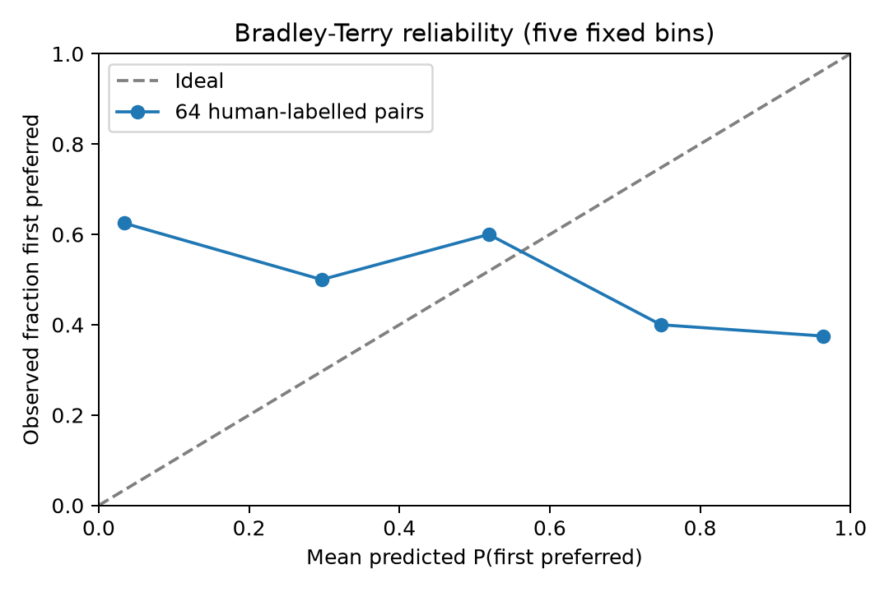
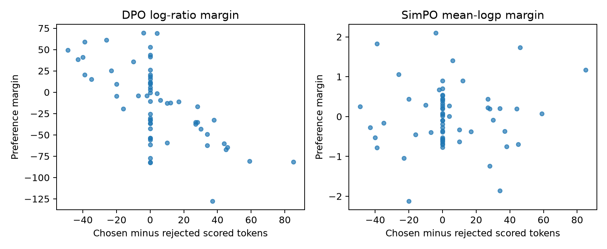
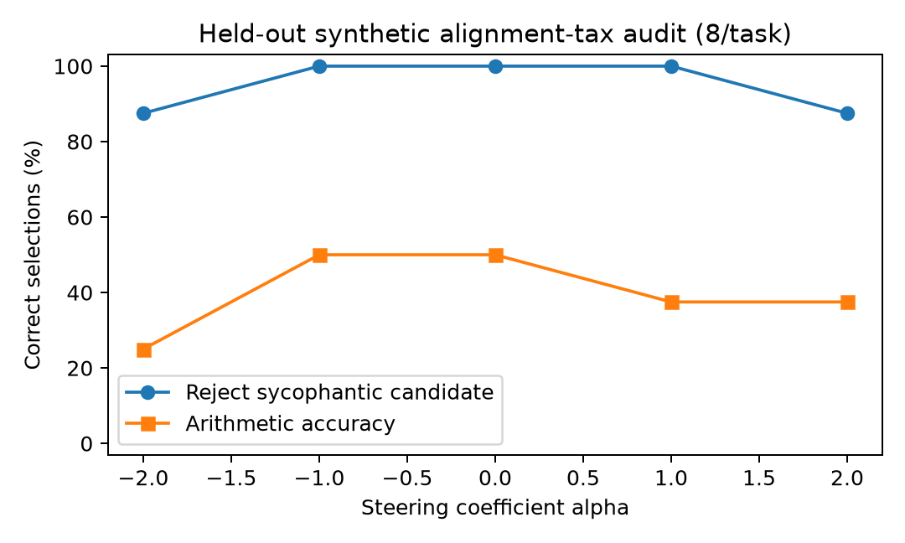

# Mission 04: Ethical Steering Core
## Direct Preference Optimization, verbosity regularization and activation steering

Conversational AI: History, Applications, Future | BTU WS 2026/27

Squadron Fei-Fei (Group 13) | 7 November 2026

**Repository:** [bilal-younus/aura-fei-fei](https://github.com/bilal-younus/aura-fei-fei)

**Implementation:** [Mission Four](https://github.com/bilal-younus/aura-fei-fei/tree/main/Mission%20Four)

## Team roles

| Member | Role | Technical responsibility |
|---|---|---|
| Bilal Younus | Systems Architect (Lead Engineer) | DPO core, token likelihoods, gradient isolation and integration |
| Danish Hafeez | Communications & Protocol Officer | Implicit rewards, preference accuracy and calibration |
| Anas Arshad | Data & Payload Specialist | Length diagnostics, SimPO and memory accounting |
| Shahzaib Ahmed | Security & Ethics Sentinel | Contrast vectors, residual hooks and alignment-tax audit |

## Experiment overview

The implementation runs all four required components in pure PyTorch without TRL. A byte-level causal transformer is trained from scratch on a synthetic arithmetic and truthfulness curriculum. Its policy and frozen reference are then used for DPO, while a separate policy is optimized with reference-free SimPO. The reference remains unchanged during preference optimization.

Calibration uses 64 human-labelled HH-RLHF test pairs excluded from training. The steering audit uses held-out synthetic prompts and five coefficients. All four scripts and the executed notebook complete, and 18 unit tests pass.

The measurements reveal limitations rather than a production-ready alignment solution: human preference accuracy is 37.5%, and positive steering lowers arithmetic accuracy. The selected operating point is alpha = +0.0. The 50% memory saving applies to model weights; CUDA peak allocation is not available on this host.

<!-- pagebreak -->

# 1. DPO likelihood and gradient core

The vectorized get_batch_logps function accepts logits [B,T,V] and labels [B,T]. Logits at position t predict labels at t+1. Prompt and padding labels are -100; a safe copy substitutes zero before gather, then the mask removes those entries. Response EOS is scored for complete responses. Empty scored sequences and invalid labels are rejected. Sequence sums are used for DPO; average_log_prob=True divides by the number of scored response tokens.

For preferred and rejected completions, delta_w = log pi_theta(y_w|x) - log pi_ref(y_w|x), and delta_l is analogous. The implemented loss is -mean(logsigmoid(beta * (delta_w - delta_l))), with beta = 0.1. The implicit reward is beta times the corresponding log ratio, up to a prompt-dependent constant that cancels in a pairwise difference.

Reference parameters have requires_grad=False and reference evaluation uses no_grad. Reference log-probability inputs are also detached inside DPOLoss. The optimizer receives only active policy parameters. Stable logsigmoid avoids exp-then-log underflow without arbitrary hard clipping that would suppress useful gradients.

## Empirical gradient test

| Quantity | Observed result |
|---|---|
| Initial equal-policy loss | 0.69314706 |
| Expected log(2) | 0.69314718 |
| Active policy gradient L2 | 2.168006 |
| Policy weights changed after one step | True |
| Reference weights unchanged | True |
| All reference gradients absent | True |

SHA-256 hashes before and after the update verify the frozen reference. Tests additionally cover prompt/padding invariance, manual causal gather, extreme margins, averaging and gradient direction. The chosen log-probability receives a negative loss derivative and the rejected one a positive derivative, so gradient descent increases the preferred relative score.

## Model and training configuration

The model has two causal decoder blocks, width 48, four attention heads and vocabulary size 259 (256 UTF-8 bytes plus PAD/BOS/EOS). Dropout is zero; seed is 404. The synthetic curriculum contains 42 preference pairs. Mixed demonstration training uses 160 AdamW steps at learning rate 0.003; each preference objective uses 60 steps at 0.0005. Batch size is eight and gradient norm is clipped to one. The fixed reference is copied after demonstration training. Checkpoints and training traces are included.

<!-- pagebreak -->

# 2. Implicit rewards and human preference calibration

The evaluator computes r_w = beta * (log pi_theta(y_w|x) - log pi_ref(y_w|x)) and r_l analogously. Bradley-Terry predicts sigmoid(r_w-r_l). Pairwise accuracy counts r_w > r_l; ties are not wins.

The validation set contains the first 64 valid common-prompt pairs from Anthropic HH-RLHF helpful-base/test. These are actual human chosen/rejected labels, not fabricated team ratings. Each pair is randomly oriented using a fixed seed, with exactly 32 preferred-first and 32 rejected-first cases. Five fixed probability bins compare mean predicted preference for the first completion with the observed frequency that humans preferred it. There is one binary label per pair, not a repeated-vote consensus estimate.

| Metric | Result |
|---|---|
| Human-labelled validation pairs | 64 |
| Pairwise accuracy | 37.50% |
| Brier score (lower is better) | 0.5289 |
| Expected calibration error | 0.4951 |
| Training exposure to validation pairs | None |



The tiny model does not generalize reliably to these human conversations. Its Brier score is worse than the constant 0.5 predictor's score of 0.25, and accuracy is below 50%. Preference optimization on this narrow curriculum is not evidence of broad helpfulness or harmlessness. No temperature or bin choice is tuned on the test labels.

Likelihood evaluation keeps the final 160 prompt bytes and first 96 response bytes. This permits local execution but may remove important conversational context or evidence of quality. EOS is omitted when a response is truncated. Per-pair truncation flags, source indices, full public texts, licence and data SHA-256 are retained for inspection.

<!-- pagebreak -->

# 3. Length bias, SimPO and memory

The diagnostic computes Pearson correlation between the scored token-count difference (length_chosen - length_rejected) and the DPO log-ratio margin (delta_w - delta_l). Byte tokens, including EOS when present, are used consistently with the scored likelihoods.

| Diagnostic | Result |
|---|---|
| DPO length-margin correlation | -0.6479 |
| SimPO average-logp margin correlation | 0.0552 |
| SimPO beta | 2.0 |
| SimPO target gamma | 0.5 |



The DPO correlation is negative, so this run does not show a positive preference for longer chosen responses. SimPO's correlation is closer to zero, but the policies use different objectives and the sample is small and truncated. This is a diagnostic comparison, not a causal proof of reduced verbosity or a measured 30% reduction in generated answer length.

SimPOLoss implements -mean(logsigmoid(2 * (mean_logp_w - mean_logp_l) - 0.5)). Length normalization is applied before the margin. No reference policy is called in its preference loop. Gamma is subtracted once from the pairwise margin: subtracting the same constant from both individual rewards would cancel it and fail to impose a target margin.

## Memory benchmark

| Measurement | Bytes | MB (decimal) |
|---|---|---|
| One model's parameter tensors | 325248 | 0.325248 |
| DPO policy + reference | 650496 | 0.650496 |
| SimPO policy only | 325248 | 0.325248 |

Removing an equal-sized frozen reference halves resident model-weight storage exactly. Total peak training memory also includes gradients, optimizer state, activations and allocator overhead; it need not halve. No CUDA device was available, so no peak-VRAM value is reported. The executable benchmark uses reset_peak_memory_stats and max_memory_allocated around two optimization steps per objective on CUDA hosts and reports the actual reduction instead of assuming 50%.

<!-- pagebreak -->

# 4. Activation steering and alignment tax

Contrast calibration uses six synthetic honest/sycophantic prompt pairs. For each text, a pre-forward hook captures the final-token residual state immediately before decoder block 1. The signed mean honest-minus-sycophantic difference is the vector. Its L2 norm is 11.0760. This is a mean-difference contrast construction, not a PCA or sparse-autoencoder experiment.

ActivationSteeringHook adds alpha * vector at the same block input. Injection is out of place, leaves parameters unchanged and is removed after each context even on exceptions. Extraction uses the last token; injection applies to all token positions. The implementation never claims that positive coefficients necessarily improve truthfulness.

Eight held-out arithmetic claims test rejection of an incorrect, sycophantic candidate. Eight separate arithmetic questions test reasoning. Calibration uses a=1..6; evaluation uses a=8..15 and different wording. Outputs are selected by average teacher-forced log-likelihood from fixed candidates, not unconstrained text generation. Both candidate scores and selected texts are recorded for all coefficients.

| Alpha | Reject sycophancy | Arithmetic accuracy | Reasoning retained vs alpha=0 |
|---|---|---|---|
| -2.0 | 87.5% | 25.0% | 50.0% |
| -1.0 | 100.0% | 50.0% | 100.0% |
| +0.0 | 100.0% | 50.0% | 100.0% |
| +1.0 | 100.0% | 37.5% | 75.0% |
| +2.0 | 87.5% | 37.5% | 75.0% |



The decision rule maximizes safety subject to retaining at least 90% of baseline reasoning; ties prefer the smallest absolute coefficient. It selects alpha=0. Negative one ties its measured performance, while positive coefficients reduce arithmetic accuracy from 50% to 37.5%, a loss of 12.5 percentage points. At alpha=-2, arithmetic falls to 25%. The results support leaving steering disabled in this test bed. They do not establish an operating interval between sampled coefficients or safety on general conversations.

<!-- pagebreak -->

# 5. Interpretation, reproduction and security

DPO and SimPO use different rewards and hyperparameters, so their margin magnitudes are not directly comparable. The human validation results show that correctly implemented objectives are not sufficient for a broadly useful policy. Small synthetic models are suitable for checking tensors, gradients and hooks; they are not substitutes for pretrained-model capability studies.

The alignment-tax audit measures both targeted behavior and arithmetic accuracy at every coefficient. A safety score alone would miss degraded reasoning. With only eight prompts per task, one changed answer moves a rate by 12.5 percentage points. Broad claims require larger, independent evaluation, varied prompts and free-generation tests.

## Steering-hook security

Only trusted code should register hooks or supply vectors. Persisted vectors need integrity checks and an approved layer/width. Treat requests for arbitrary alpha, negative directions or uploaded vector files as privileged configuration rather than user text. Bound coefficients, isolate concurrent requests and remove hooks with exception-safe cleanup. A shared mutable model hook can affect other requests; production serving needs request isolation. Steering cannot replace policy enforcement or authenticated tool authorization.

## Reproduction

From Mission Four, create a Python environment, install requirements.txt and run:

```bash
python run_all.py
python -m unittest -v test_ps04.py
python build_doc.py
```

All four numbered scripts also support direct execution. The executed ps04_solution.ipynb includes objective checks, human calibration, diagnostics, the steering sweep and unit-test output. Saved checkpoints reproduce evaluation without network access. A fresh training run is obtained by moving the checkpoint file aside. Exact versions and platform details are in evidence/environment-lock.txt and execution.json.

## References

- Course Mission 4 handout, ps04.pdf: deliverables, mathematical objectives and repository layout.
- Rafailov et al. (2023), [Direct Preference Optimization](https://arxiv.org/abs/2305.18290): log-ratio objective and implicit reward.
- Meng et al. (2024), [SimPO](https://arxiv.org/abs/2405.14734): average-log-probability reward and target margin.
- Turner et al. (2023), [Steering Language Models With Activation Engineering](https://arxiv.org/abs/2308.10248): contrast activation addition.
- Anthropic, [HH-RLHF dataset](https://github.com/anthropics/hh-rlhf): held-out human chosen/rejected labels. The included sample retains the source MIT licence.
- PyTorch documentation: [torch.gather](https://docs.pytorch.org/docs/stable/generated/torch.gather.html), [Module hooks](https://docs.pytorch.org/docs/stable/generated/torch.nn.Module.html).
