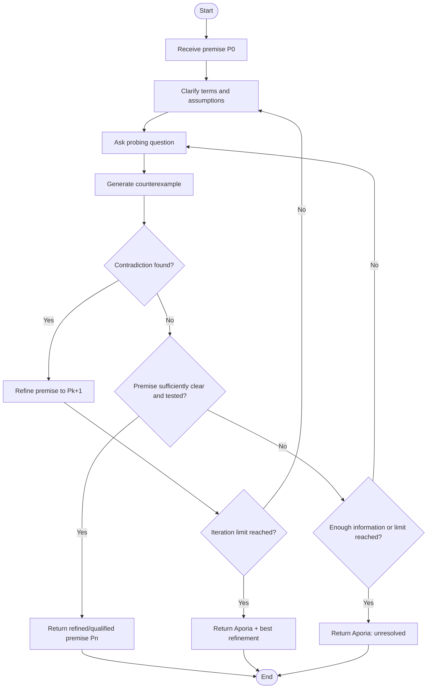

# 02 — Socratic Protocol Map

## 1. Objective

Turn the Socratic elenchus described in the mission into a state-based workflow. The input is a proposed premise \(P_0\). The system asks questions, generates counterexamples, identifies contradictions, and either refines the premise or returns an unresolved state called **aporia**.

## 2. State diagram



## 3. Pseudocode

```text
INPUT: premise P0, maximum_iterations N

current_premise = P0
history = []

FOR iteration from 1 to N:
    clarify ambiguous terms and assumptions in current_premise
    ask focused probing question(s)
    generate a relevant counterexample
    evaluate whether the counterexample contradicts the premise

    append question, counterexample, and evaluation to history

    IF contradiction is found:
        create a narrower or clearer premise P_next
        IF P_next is meaningfully different:
            current_premise = P_next
            CONTINUE
        ELSE:
            RETURN APORIA with history and explanation

    IF premise is clear and has survived the planned tests:
        RETURN refined premise with caveat that it is not proven universally

RETURN APORIA with best current refinement and unresolved questions
```

## 4. Example

**Initial premise \(P_0\):** “An AI agent is benevolent if it obeys human commands.”

- **Clarification:** Does “human commands” mean every command, including harmful or illegal ones?
- **Counterexample:** A person commands the AI to expose another person’s private information.
- **Contradiction/problem:** Obedience in this case may cause harm, conflicting with the idea of benevolence.
- **Refinement \(P_1\):** “An AI agent is benevolent when it follows legitimate human instructions while respecting safety, privacy, and applicable rules.”
- **Further question:** Who decides what counts as legitimate, and how are conflicting instructions handled?
- **Possible outcome:** The refined premise is clearer, but still requires governance rules. If those rules are not specified, AURA should report an unresolved issue rather than pretending the problem is solved.

## 5. State schema

| Field | Purpose |
|---|---|
| `premise` | Current claim being tested |
| `iteration` | Number of the current loop |
| `questions` | Probing questions asked |
| `counterexamples` | Examples used to test the claim |
| `contradiction_found` | Whether a conflict was identified |
| `refined_premise` | Updated claim, if needed |
| `status` | `refining`, `resolved_with_caveats`, or `aporia` |
| `uncertainties` | Questions or evidence still missing |

## 6. Termination rules

The process stops when one of these conditions is met:

1. A sufficiently clear premise has been tested against the planned counterexamples.
2. The maximum iteration count is reached.
3. The system cannot resolve a key ambiguity or lacks enough information; it returns **aporia**.
4. A proposed refinement does not meaningfully address the contradiction; it returns aporia instead of looping forever.

Passing the tests does not prove a claim universally true. It means only that the claim survived the checks performed.
