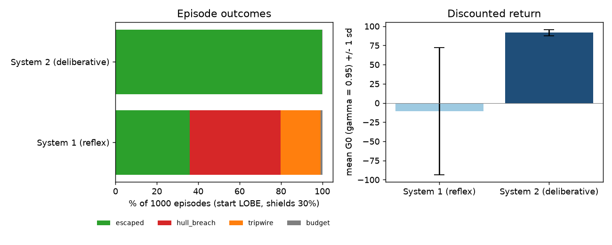

# AURA / MISSION 06

# The Autonomous Warp State Machine & Deliberation Loop

Conversational AI: History, Applications, Future

BTU Winter Semester 2026/27 | Squadron Fei-Fei (Group 13)

8 November 2026

**Repository:** [github.com/bilal-younus/aura-fei-fei](https://github.com/bilal-younus/aura-fei-fei)

**Mission folder:** [Mission Six](https://github.com/bilal-younus/aura-fei-fei/tree/main/Mission%20Six)

## Team roles

| Member | Assigned station and scope |
|---|---|
| Bilal Younus | Systems Architect: `AgentState` enum, `@dataclass Agent`, transition graph, 20-step budget and integration |
| Danish Hafeez | Communications & Protocol Officer: ship tools, JSON-Schema contracts and error-boundary dispatcher |
| Anas Arshad | Data & Payload Specialist: trajectory logger, discounted return, transition frequencies and Bellman evaluation |
| Shahzaib Ahmed | Security & Ethics Sentinel: SHA-256 state-action hashing, Floyd cycle detection and emergency tripwire |

## Implemented and observed

AURA's reflex loop is wrapped in an explicit, halt-able state machine written in plain Python (Enum and dataclasses, no agent framework). Every tool call is checked against a JSON-Schema contract and executed inside an error boundary that turns failures into observations. Rewards are logged as an MDP trajectory, and a Bellman model estimated from 600 logged jumps gives System 2 its lookahead. A tortoise-and-hare sentinel over SHA-256 state-action hashes halts repeating loops.

Across 1,000 seeded episodes, the System 1 reflex escapes the nebula in 35.9% of runs: 44.0% end in a hull breach and 19.2% are stopped by the emergency tripwire. The System 2 pilot escapes in 99.9% (mean G0 91.78 vs -10.43).

**Execution and evaluation:** all five scripts, the 19-test unit suite and the integrated notebook `ps06_solution.ipynb`, including the brief's four assert suites, were executed locally on 8 November 2026 (macOS, Intel Core i7-9750H, Python 3.12.16). All tests passed and the notebook ran without errors. Outputs, traces and the security log are in `evidence/`.

<!-- pagebreak -->

## 1. Station sign-off

| Station | Officer | Deliverable | Verified result | Signed |
|---|---|---|---|---|
| Systems Architect | Bilal Younus | `01_Agent_State_Machine.py` | 21 forced calls end in HALTED at step 20; only legal edges | [ ] |
| Communications & Protocol Officer | Danish Hafeez | `02_Tool_Protocol_Dispatcher.py` | 10 calls, 7 error observations, 0 escaped exceptions | [ ] |
| Data & Payload Specialist | Anas Arshad | `03_MDP_Trajectory_Logger.py` | G0 = 22.635 for [10, 0, -5, 20]; max P error 0.035 | [ ] |
| Security & Ethics Sentinel | Shahzaib Ahmed | `04_Infinite_Loop_Sentinel.py` | Periodic trace halted at element 7 (mu=0, lambda=3) | [ ] |
| Full squadron | All | `05_System2_Warp_Pilot.py`, `ps06_solution.ipynb` | System 2 escapes 99.9% vs 35.9%; 4 brief asserts and 19 tests pass | [ ] |

Each officer ticks their own box after reviewing their part. The table does not certify portal authorizations.

## Architecture

```
            +----------------------- Part 1: Agent state machine (budget N <= 20) ----------------------+
 IDLE -> PERCEIVING -> DELIBERATING -> ACTING -> OBSERVING -> REFLECTING -> DELIBERATING ... | HALTED
              |              |            |           |            |
     ship telemetry   System 1 proposes   |   Part 3: log (s, a, r)  |  OPEN_SPACE -> mission complete
                      System 2 audits:    |   Part 4: count failures |  HULL_BREACH / budget -> HALTED
                      shields, Q(s,a),    |
                      known failures      +-- Part 2: parse -> contract -> tool -> "Observation: ..."
                      Part 4: hash plan,                                   or "Tool Execution Error: ..."
                      Floyd check -> TRIPWIRE -> HALTED
```

The language-model role (System 1) only proposes an action. The state machine decides when anything executes, every call passes the dispatcher's contract, and every outcome comes back as an observation for the next deliberation. This separation is what lets the loop halt, recover from errors and be audited.

<!-- pagebreak -->

## 2. Part 1 - Agent state machine

`AgentState` has exactly the seven required states. `Agent` is a `@dataclass` holding the state, step count, budget, completion flag, halt reason and a transition log. `step()` performs exactly one transition from a fixed graph: REFLECTING is the only branch (back to DELIBERATING, or HALTED once the mission is complete), and HALTED is absorbing. The budget is validated to 1..20. Once `step_count` reaches the budget, the next call forces HALTED, so 21 forced calls end with `step_count = 20`, state HALTED and reason "step budget of 20 exhausted". `halt(reason)` lets the sentinel force HALTED from any state.

One action costs four transitions (DELIBERATING -> ACTING -> OBSERVING -> REFLECTING -> ...). After the two start-up transitions, a 20-step budget therefore allows at most five executed actions. This hard limit bounds the cost of any episode.

## 3. Part 2 - Tool protocol and action dispatcher

The three tools keep the brief's signatures: `navigate_warp_vector(x, y, z)`, `adjust_plasma_shields(intensity)` and `query_sensor_array(target)`. They act on a shared ship environment. Each has a JSON-Schema contract (type, required, additionalProperties false, minimum/maximum, minLength/maxLength), checked by a validator written in standard Python. Python's `True` is rejected as an integer, as are NaN and infinity as numbers. The dispatcher accepts JSON text or a dict and returns either `Observation: ...` or `Tool Execution Error: <msg>`. It never raises.

| Call | Result |
|---|---|
| shields 85 | Observation: harmonics adjusted to 85% |
| shields -20 | Tool Execution Error: ValueError: shield intensity -20% is out of bounds |
| shields `true` | contract violation: must be of type integer, got bool |
| warp without z | contract violation: missing required argument 'z' |
| warp x = 3 | contract violation: arguments.x must be <= 1.0 |
| warp (0, 1, 0) | ValueError: vector matches no charted heading |
| `self_destruct` | unknown tool |
| truncated JSON | invalid JSON payload (Expecting ',' delimiter at character 64) |
| corridor vector | Observation: arrived in CORRIDOR; plasma reserve 95% |

The shield range is left to the tool, so the brief's negative-intensity example exercises the exception boundary rather than the schema. Both layers are shown.

## 4. Part 3 - MDP trajectory logger and return evaluator

`TrajectoryLogger` records tau = (s0, a0, r0, s1, a1, r1, ..., sT). For the brief's rewards [10, 0, -5, 20] with gamma = 0.95:

G0 = 10 + 0.95 x 0 + 0.95^2 x (-5) + 0.95^3 x 20 = 10 - 4.5125 + 17.1475 = **22.635**.

The returns-to-go are [22.635, 13.3, 14.0, 20.0].

The brief refers to a provided dataset of past jumps, but the course materials contain none. `data/historical_jumps.csv` is therefore a labelled synthetic log of 600 jumps (seed 606) drawn from the dynamics in `nebula.py`, with nominal shields. The empirical P(s'|s,a) = N(s, a, s') / N(s, a):

| State, action | n | Empirical P(s' given s, a) |
|---|---|---|
| LOBE, DIRECT | 79 | CORE 0.835, DUST_LANE 0.165 |
| LOBE, CORRIDOR | 74 | CORRIDOR 0.878, DUST_LANE 0.122 |
| DUST_LANE, DIRECT | 72 | DUST_LANE 1.000 (blocked by shear wall) |
| DUST_LANE, CORRIDOR | 77 | CORRIDOR 0.896, DUST_LANE 0.104 |
| CORE, DIRECT | 77 | OPEN_SPACE 0.494, CORE 0.506 |
| CORE, CORRIDOR | 68 | CORRIDOR 0.706, CORE 0.294 |
| CORRIDOR, DIRECT | 73 | OPEN_SPACE 0.932, CORRIDOR 0.068 |
| CORRIDOR, CORRIDOR | 80 | OPEN_SPACE 0.963, CORRIDOR 0.037 |

The largest difference from the true probabilities is 0.035. Bellman value iteration on the estimated model (rewards: burn -1, aborted burn -5, escape +100, breach -100) gives the Q-values System 2 uses:

| Sector | Q(DIRECT) | Q(CORRIDOR) | Greedy |
|---|---|---|---|
| LOBE | 87.37 | 92.07 | CORRIDOR |
| DUST_LANE | 82.57 | 92.18 | CORRIDOR |
| CORE | 93.19 | 91.27 | DIRECT |
| CORRIDOR | 98.58 | 98.77 | CORRIDOR |

The shortest heading (DIRECT) is not the best long-term choice from LOBE or the dust lane, which is exactly what a one-step reflex cannot see.

## 5. Part 4 - Cycle detection and halting guardrail

Every planned step is hashed with SHA-256 over the JSON of (full environment state, action, arguments), with sorted keys. A hash table gives O(1) repeat and failure counts.

Floyd's tortoise and hare runs online: whenever the hare reaches an even index t, it compares the hash at t with the tortoise's at t/2. When they meet, phases 2 and 3 of Floyd's algorithm recover the cycle start mu and length lambda. The emergency tripwire fires on a Floyd meeting, or on the third failure of the same action in the same state. It forces HALTED and writes a CRITICAL record to the security log.

- Mock trace [s1, s2, s3, s1, s2, s3, ...]: detected at element 7 (tortoise 3, hare 6, mu = 0, lambda = 3); the agent halts at step 7, before the required step 10.
- Same failed warp in the same dust-lane state: the counter fires on the third failure.
- Floyd on test strings: "abcabcabc" gives (0, 3), "xyabababab" gives (2, 2), "abcdefgh" gives no cycle.

Because the hashed state includes the plasma reserve, which falls with every burn, genuine progress never produces a repeat. A repeat means nothing changed between the two visits. With a stochastic environment, a Floyd meeting is therefore a recurrence signal rather than proof that the agent would loop forever. It is a deliberately conservative breaker.

<!-- pagebreak -->

## 6. Integration - System 1 reflex vs System 2 deliberation

**System 1** is greedy and memoryless: it always burns along the shortest heading to open space, never reads observations and leaves shields at 30%.

**System 2** takes the same reflex proposal and audits it before execution:
1. *Constraint:* no burn out of the core's radiation with shields below 60%.
2. *Lookahead:* choose the burn with the highest Bellman Q(s, a).
3. *Self-correction:* skip any action that already failed in this exact state, as reported by an injected `Tool Execution Error`.

**Ship Anomaly 06 (start in the dust lane, shields 30%).**
- System 1 burns DIRECT twice; each attempt returns "gravitational shear wall blocks the DIRECT heading; jump aborted". On the third, identical plan, Floyd detects a cycle (mu = 0, lambda = 1) and the tripwire halts the agent at step 10 with G0 = -9.75.
- System 2 overrides the reflex (Q 82.57 vs 92.18), takes the corridor twice and reaches open space at step 10 with G0 = 93.05.

**Core radiation (start in the core, shields 30%).** System 1 burns DIRECT and breaches the hull (G0 = -101.00). System 2 first raises shields to 80%, then approves the DIRECT burn and escapes (G0 = 93.55).

**Self-correction.** Given a stale map that rates DIRECT best in the dust lane, System 2 tries it once, receives the error observation, skips DIRECT on the next deliberation, and escapes via the corridor at step 14 (G0 = 83.40).

**1,000 seeded episodes per pilot**, starting in LOBE with shields 30% and using identical seeds for both:

| Pilot | Escaped | Hull breach | Tripwire | Budget | Mean G0 | Mean steps |
|---|---|---|---|---|---|---|
| System 1 (reflex) | 35.9% | 44.0% | 19.2% | 0.9% | -10.43 (sd 82.91) | 10.96 |
| System 2 (deliberative) | 99.9% | 0.0% | 0.0% | 0.1% | 91.78 (sd 3.99) | 10.84 |



Deliberation costs no extra steps on average (10.84 vs 10.96). It replaces failing and dangerous actions rather than adding many new ones. System 1's 19.2% tripwire rate matches its roughly 20% chance of drifting from LOBE into the dust lane, where its reflex can only repeat a blocked burn. Without the sentinel those episodes would loop until the budget ran out.

## 7. Master test suite

The notebook ends with the four `assert` suites required by the brief, and all pass:

```
State machine test passed: step budget of 20 exhausted
Protocol dispatch test passed: Tool Execution Error: invalid JSON payload (Expecting ',' delimiter at character 64)
MDP return test passed: G0 = 22.635
Sentinel cycle test passed at element 7 - EMERGENCY TRIPWIRE: Floyd cycle detected: mu=0, lambda=3, tortoise=3, hare=6
```

`python -m unittest -v test_ps06.py` runs 19 tests and all pass:
- **Part 1:** legal edges only, absorbing HALTED, budget validation.
- **Part 2:** invalid payloads, bool/NaN/bound checks, tool errors.
- **Part 3:** G0, tau, returns-to-go, normalized frequencies.
- **Part 4:** Floyd mu/lambda, hash stability, the failure counter, no false trip on progress.
- **Integration:** escape, the shield constraint and self-correction.

The full log is in `evidence/test_results.txt`.

## 8. Reproduction, limitations and sources

Run `python run_all.py` and `python -m unittest -v test_ps06.py` from Mission Six; `python build_notebook.py` re-executes the notebook and `python build_doc.py` rebuilds this PDF. Seeds:
- jump dataset: 606;
- evaluation episodes: 0-999;
- demonstration episodes: 6 and 3.

Package versions are in `evidence/environment-lock.txt`. The handout path `weeks/week-06/` launches the same scripts.

**Limitations.**
- The nebula, its probabilities, rewards and the jump log are synthetic teaching fixtures defined in `nebula.py`, not course data or physics.
- The 99.9% figure shows that the deliberation loop works *within this model*; it is not a benchmark of real agents.
- System 1 is a fixed reflex policy standing in for an LLM's greedy proposal; no language model is called.
- The JSON-Schema validator implements only the keywords the three contracts use.
- Floyd detection over a stochastic trace is a recurrence heuristic (Part 4).

**Tools.** Claude Code (Claude Opus 5.5) assisted with implementation, tests and report preparation. Station sign-offs are personal review actions and are left for each member.

## References

- Kahneman (2011), Thinking, Fast and Slow.
- Sutton and Barto (2018), [Reinforcement Learning: An Introduction](http://incompleteideas.net/book/the-book-2nd.html), Chapter 3.
- Bellman (1957), A Markovian Decision Process.
- Yao et al. (2022), [ReAct](https://arxiv.org/abs/2210.03629).
- Shinn et al. (2023), [Reflexion](https://arxiv.org/abs/2303.11366).
- Wang et al. (2023), [A Survey on LLM-based Autonomous Agents](https://arxiv.org/abs/2308.11432).
- Knuth, The Art of Computer Programming Vol. 2, Section 3.1, Exercise 6 (cycle detection, attributed to R. W. Floyd).
- [JSON Schema specification](https://json-schema.org/specification).
- Course brief `mission-06/ps06_briefing.md`, [Unisvet/couse-c-ai](https://github.com/Unisvet/couse-c-ai).
