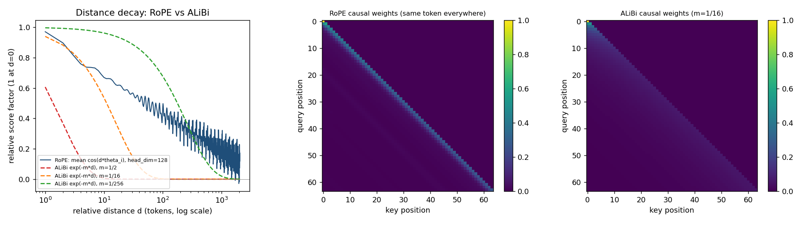

# AURA / MISSION 03

## Multi-Head Attention, RoPE Vector Rotation & Grouped-Query KV-Cache Optimization

Conversational AI: History, Applications, Future  
BTU Winter Semester 2026/27 | Squadron Fei-Fei (Group 13)  
26 October 2026

**Repository:** [github.com/bilal-younus/aura-fei-fei](https://github.com/bilal-younus/aura-fei-fei)  
**Mission folder:** [Mission Three](https://github.com/bilal-younus/aura-fei-fei/tree/main/Mission%20Three)

### Team roles

| Member | Assigned station and scope |
|---|---|
| Bilal Younus | Systems Architect: multi-head self-attention core, variance test, notebook integration and repository |
| Danish Hafeez | Communications & Protocol Officer: RoPE engine, relative invariance check and RoPE vs ALiBi decay plot |
| Anas Arshad | Data & Payload Specialist; Security & Ethics Sentinel: GQA and KV-cache benchmark, FlashAttention IO derivation and KV-cache DoS audit |

Three members cover four station roles. The table records the team role allocation.

### Implemented and observed

The PyTorch implementation builds multi-head self-attention from scratch with causal masking, Rotary Position Embeddings, Grouped-Query Attention and a stateful KV-cache. Scaling by 1/√d_k restores unit score variance (1.0027 at d_k = 64), and the attention output matches PyTorch's fused kernel to 6e-8. RoPE scores stay invariant under position shifts (maximum relative error 2.4e-6 over 200 random trials). Cached decoding reproduces the full forward pass, and at 32,768 tokens GQA 4:1 decodes 4.4x faster than MHA with a 4x smaller cache. The security audit derives FlashAttention's IO complexity and shows one 80 GB accelerator running out of memory at the 8th 64k-token session; PagedAttention with per-client quotas serves 133 of 160 legitimate chats instead of 6.

**Execution and evaluation:** all four scripts, the 18-test unit suite and the integrated notebook `ps03_solution.ipynb` were executed locally on 26 October 2026 (macOS, Intel Core i7-9750H, Python 3.9.6, PyTorch 2.2.2, CPU). All tests passed and the notebook ran without errors. Raw outputs, benchmark JSON and the RoPE/ALiBi plot are preserved in `evidence/`.

---

## 1. Squadron roster & station sign-off

| Station | Officer | Deliverable | Verified result | Sign-off |
|---|---|---|---|---|
| Systems Architect (Lead Engineer) | Bilal Younus | `01_MultiHead_Attention_Core.py` | Var(q·k/√d_k) = 1.0027 at d_k = 64; matches torch SDPA to 6e-8 | [ ] |
| Communications & Protocol Officer | Danish Hafeez | `02_RoPE_Positional_Engine.py` | Shift invariance, max relative error 2.4e-6 over 200 random trials | [ ] |
| Data & Payload Specialist | Anas Arshad | `03_GQA_and_KVCache_Benchmark.py` | Cached decoding = full forward (1.6e-7); GQA 4.4x faster than MHA at N = 32,768 | [ ] |
| Security & Ethics Sentinel | Anas Arshad | `04_Memory_Hierarchy_and_Safety_Audit.md` | OOM at the 8th 64k session; paging + quotas serve 133/160 vs 6/160 | [ ] |
| Full squadron | All | `ps03_solution.ipynb` | Executed end to end; 18/18 unit tests pass | [ ] |

Three members cover four stations, as in Missions 1 and 2. Each officer ticks their own box after reviewing their part; the table does not certify portal authorizations.

---

## 2. Integrated architecture

```
 tokens x (b, n, d_model)
        |
        v
 +--- Part 1: MultiHeadSelfAttention / Part 3: GQAAttention ----------------------------
 |  W_Q -> Q (b, H_Q, n, d)      W_K -> K (b, H_KV, n, d)      W_V -> V (b, H_KV, n, d)
 |        |                             |                             |
 |        +----- Part 2: apply_rope ----+  rotate pairs by m*theta_i  |
 |        |                             |                             |
 |        |                    Part 3: KVCache.append(K_t, V_t) <-----+
 |        |                    (keeps K, V of all past tokens; decode adds 1 token/step)
 |        v                             v
 |  group H_Q/H_KV query heads per KV head: softmax(Q K^T / sqrt(d) + causal mask) V
 |        |
 |        v   concat heads -> W_O -> (b, n, d_model)
 +---------------------------------------------------------------------------------------
        |
        v
 Part 4 audit: HBM <-> SRAM traffic (FlashAttention tiling), KV-cache growth per session,
               OOM point, PagedAttention blocks, per-client quotas, MLA latent cache
```

- **MHA:** H_KV = H_Q = 32.
- **GQA 4:1:** H_Q = 32, H_KV = 8. Each KV head serves 4 query heads.
- **MQA:** H_KV = 1.

Instead of copying K/V with `repeat_interleave`, the grouped layer folds each query group into the row dimension, `(b, H_KV, group·n, d)`. Each cached K/V head is then read once. A test checks this against the textbook `repeat_interleave` + `torch.nn.functional.scaled_dot_product_attention` result.

---

## 3. Station A - Systems Architect: scaled dot-product & multi-head attention

`MultiHeadSelfAttention(nn.Module)` is written in pure PyTorch and does not use `nn.MultiheadAttention`:
- W_Q, W_K, W_V, W_O ∈ R^(d_model x d_model);
- head split `(b, n, h, d) -> (b, h, n, d)`;
- an additive lower-triangular causal mask (-inf above the diagonal);
- an optional padding mask;
- returned attention weights.

**Variance preservation.** For q, k ~ N(0, 1) with d_k components, q·k is a sum of d_k independent products, each with variance 1, so Var(q·k) = d_k. Dividing by √d_k restores unit variance.

| d_k | Var(q·k) | Var(q·k / √d_k) | Result |
|---:|---:|---:|---|
| 16 | 16.311 | 1.0195 | PASS |
| 64 | 64.176 | 1.0027 | PASS |
| 128 | 128.128 | 1.0010 | PASS |

Without scaling, softmax saturates: at d_k = 64 the mean largest attention weight is **0.771** unscaled versus **0.069** scaled, so unscaled softmax is almost one-hot and its gradients vanish.

**Forward pass** (d_model = 256, 4 heads, input (2, 16, 256)):
- output shape (2, 16, 256), attention shape (2, 4, 16, 16);
- largest weight on any future token = 0.0;
- every row sums to 1;
- largest difference from PyTorch's fused SDPA = **5.96e-8**.

---

## 4. Station B - Protocol Officer: Rotary Position Embeddings

`precompute_freqs_cis` builds e^(i·m·θ_i) with θ_i = 10000^(-2(i-1)/d). `apply_rope(x, freqs_cis)` views each pair (x_2i, x_2i+1) as a complex number and multiplies it by that phase, which is an exact 2D rotation by m·θ_i. A unit test compares it with the explicit cos/sin rotation matrix.

**Why relative invariance holds.**

⟨R_m q, R_n k⟩ = qᵀ R_mᵀ R_n k = qᵀ R_(n-m) k

The score depends only on n - m, so shifting both positions by δ leaves it unchanged.

**Empirical check.** Over 200 random (q, k, m, n, δ) with positions up to 8,192, the largest relative error was **2.38e-6**. Example: ⟨RoPE(q,763), RoPE(k,2235)⟩ = 5.775354, and after shifting both by δ = 379 it is 5.775355. Rotation also preserves vector norms.

*Precision finding:* the first version built the angles m·θ_i in float32. At about 8,000 rad, float32 rounding is around 5e-4 rad, and the error reached 7.4e-4. The angles are now formed in float64 and stored as complex64.

**Distance decay vs ALiBi.** RoPE self-similarity mean_i cos(d·θ_i) (head_dim = 128):

| d | 0 | 1 | 4 | 16 | 64 | 256 | 1024 | 2048 |
|---|---:|---:|---:|---:|---:|---:|---:|---:|
| RoPE | 1.000 | 0.970 | 0.759 | 0.620 | 0.477 | 0.321 | 0.204 | 0.119 |



- **RoPE** decays slowly and with oscillation, and the decay emerges from the rotation frequencies; nothing is added to the logits.
- **ALiBi** subtracts a fixed linear penalty m·d with per-head slopes 2^(-8h/H) = 1/2 ... 1/256. That gives a strictly monotone exp(-m·d) decay: very local heads (m = 1/2 is near zero by d ≈ 10) next to nearly global ones (m = 1/256).
- The heatmaps feed the same token to every position, so only position shapes the weights. RoPE concentrates on the diagonal with faint periodic bands; ALiBi shows a smooth exponential falloff.

---

## 5. Station C - Data & Payload Specialist: GQA and KV-cache

**`GQAAttention`:**
- configurable H_Q : H_KV (32:32 MHA, 32:8 GQA, 32:1 MQA);
- RoPE on Q and K;
- causal masking that works both for a full prompt and for a prompt continuing an existing cache.

**`KVCache`:** a pre-allocated buffer. `append()` writes the new tokens' (K_t, V_t) and returns all cached keys and values; it raises an error on overflow.

**Correctness:** prefilling 16 tokens and then decoding 8 one at a time gives the same output as a single full forward pass (max difference **1.6e-7**).

**Benchmark.**
- *Analytic columns:* a LLaMA-3-8B-like model (32 layers, 32 query heads, head_dim 128, fp16). Bandwidth = cache bytes read per token x 50 tokens/s; weights are excluded.
- *Measured columns:* one attention layer (d_model = 4096), fp32, batch 1, on an Intel Core i7-9750H CPU (6 cores) with PyTorch 2.2.2. Each figure is the median of 9 decode steps against a cache already holding N tokens.

| N | Variant | KV-cache MB (32 layers, fp16) | GB/s at 50 tok/s | Measured 1-layer cache MB (fp32) | Measured ms / token |
|---:|---|---:|---:|---:|---:|
| 1,024 | MHA 32:32 | 512.0 | 26.84 | 32.0 | 17.81 |
| 1,024 | GQA 32:8 | 128.0 | 6.71 | 8.0 | 8.98 |
| 1,024 | MQA 32:1 | 16.0 | 0.84 | 1.0 | 8.79 |
| 4,096 | MHA 32:32 | 2,048.0 | 107.37 | 128.0 | 26.28 |
| 4,096 | GQA 32:8 | 512.0 | 26.84 | 32.0 | 10.34 |
| 4,096 | MQA 32:1 | 64.0 | 3.36 | 4.0 | 8.77 |
| 16,384 | MHA 32:32 | 8,192.0 | 429.50 | 512.0 | 45.58 |
| 16,384 | GQA 32:8 | 2,048.0 | 107.37 | 128.0 | 14.82 |
| 16,384 | MQA 32:1 | 256.0 | 13.42 | 16.0 | 9.68 |
| 32,768 | MHA 32:32 | 16,384.0 | 858.99 | 1,024.0 | 87.54 |
| 32,768 | GQA 32:8 | 4,096.0 | 214.75 | 256.0 | 20.04 |
| 32,768 | MQA 32:1 | 512.0 | 26.84 | 32.0 | 11.25 |

**Cache vs recompute** (GQA 32:8, one layer, ms per new token):

| Context | With KV-cache | Recompute whole prefix | Speed-up |
|---:|---:|---:|---:|
| 256 | 8.49 | 74.04 | 8.7x |
| 1,024 | 8.26 | 382.12 | 46.2x |
| 2,048 | 9.40 | 1,110.79 | 118.2x |

**Findings.**
- GQA cuts KV memory and bandwidth by exactly 4x and MQA by 32x.
- At 32k tokens, a 32-layer MHA cache needs 16 GiB per sequence and about 859 GB/s just to stream it at 50 tokens/s. That is above an A100's ~2 TB/s budget once batch size passes 2. GQA needs 215 GB/s.
- Measured latency follows cache size. At short context the fixed cost of the projection matmuls matters. MHA's W_K and W_V are also 4x larger (96 MB more fp32 weights read per token), which contributes to the gap at N = 1,024. At long context, cache reads dominate, and MHA's per-token time grows about 4.9x from 1k to 32k while MQA's grows 1.3x.
- Without a cache, generating token t recomputes attention over the whole prefix: Θ(t^2·d) per token and Θ(N^3·d) for N tokens, the brief's O(N^3). With the cache, the new token's K/V projection is O(1) and attention is a single query row over t cached keys, Θ(t·d). Measured: 46x faster at 1k and 118x at 2k.
- *Implementation finding:* the first GQA version broadcast K/V across query groups with `torch.matmul`, which silently copies K/V for every group. It was slower than MHA (46 ms vs 21 ms at N = 4,096). Folding the group into the query rows fixed this.

---

## 6. Station D - Security Sentinel: memory hierarchy and safety audit

The full derivation and analysis are in `04_Memory_Hierarchy_and_Safety_Audit.md`. Key results (calculated, not measured on a GPU):

- **Standard attention** moves 4Nd + 4N^2 HBM elements per head: **Θ(Nd + N^2)**. At N = 8,192 the score matrices of one 32-head layer move 17.2 GB, about 5.1 ms at 3.35 TB/s, versus 0.08 ms for Q/K/V/O.
- **FlashAttention** tiles Q, K, V into SRAM blocks (B_c = M/4d) and uses an exact online softmax (running max m and sum ℓ): 2Nd + 3Nd·⌈4Nd/M⌉ = **Θ(Nd + N^2 d^2 / M)**. With d = 128 and 192 KiB of SRAM, the element count halves. The decisive gain is extra memory: Θ(N) instead of Θ(N^2), i.e. 512 KiB instead of an **8 GiB score matrix per head at N = 65,536**.
- **DoS:** a LLaMA-3-8B-sized model (GQA 32:8) needs 128 KiB per token, so one 64k session takes 8 GiB. An 80 GB GPU has 57.0 GiB of cache budget, so **the 8th max-length session hits OOM**. Contiguous max-length buffers leave 82.4% of reserved memory empty.

| Policy | First OOM at arrival | Cadets served | Rogue sessions served | Wasted |
|---|---:|---:|---:|---:|
| Contiguous buffers (GQA) | 8 | 6 / 160 | 1 / 40 | 82.40% |
| PagedAttention (GQA) | 35 | 28 / 160 | 6 / 40 | 0.05% |
| Paged + per-client quota (GQA) | 167 | 133 / 160 | 2 / 40 | 0.22% |
| Paged + quota (MLA) | none | 160 / 160 | 2 / 40 | 0.23% |

- **PagedAttention** removes fragmentation but not demand, so it must be paired with quotas, a context-length cap, authentication and preemption.
- **MLA** caches a 512-dim latent plus a 64-dim RoPE key (576 values per token per layer). That is 14.2x smaller than MHA and 3.6x smaller than GQA 32:8.

---

## 7. Unified test suite output

```
$ python -m unittest -v test_mission03.py
test_future_tokens_do_not_change_past_outputs (test_mission03.Part1AttentionTests) ... ok
test_matches_torch_reference (test_mission03.Part1AttentionTests) ... ok
test_padding_mask (test_mission03.Part1AttentionTests) ... ok
test_shapes_and_causal_mask (test_mission03.Part1AttentionTests) ... ok
test_variance_preservation (test_mission03.Part1AttentionTests) ... ok
test_frequencies (test_mission03.Part2RopeTests) ... ok
test_long_range_decay (test_mission03.Part2RopeTests) ... ok
test_matches_explicit_2d_rotation (test_mission03.Part2RopeTests) ... ok
test_norm_preserved_and_position_zero_is_identity (test_mission03.Part2RopeTests) ... ok
test_relative_invariance (test_mission03.Part2RopeTests) ... ok
test_score_depends_only_on_offset (test_mission03.Part2RopeTests) ... ok
test_cache_memory_and_overflow (test_mission03.Part3GqaCacheTests) ... ok
test_cached_decoding_equals_full_forward (test_mission03.Part3GqaCacheTests) ... ok
test_kv_cache_sizes (test_mission03.Part3GqaCacheTests) ... ok
test_matches_repeat_interleave_reference (test_mission03.Part3GqaCacheTests) ... ok
test_io_formulas (test_mission03.Part4AuditTests) ... ok
test_kv_per_token (test_mission03.Part4AuditTests) ... ok
test_mitigations_admit_more_legitimate_sessions (test_mission03.Part4AuditTests) ... ok

----------------------------------------------------------------------
Ran 18 tests

OK
```

---

## 8. Reproduction, environment and limitations

From the `Mission Three` folder:

```bash
python3 -m venv .venv && source .venv/bin/activate
pip install -r requirements.txt
python 01_MultiHead_Attention_Core.py
python 02_RoPE_Positional_Engine.py
python 03_GQA_and_KVCache_Benchmark.py      # full benchmark, a few minutes on CPU
python 04_memory_audit_simulation.py
python -m unittest -v test_mission03.py
python build_notebook.py                    # re-executes ps03_solution.ipynb
python build_doc.py                         # mission-03-doc.md -> mission-03-doc.pdf
```

**Environment.** The recorded run used macOS on an Intel Core i7-9750H with Python 3.9.6, **PyTorch 2.2.2** and CPU only. The brief specifies PyTorch 2.4+, but PyTorch stopped publishing Intel-Mac builds after 2.2.2. The code uses only core tensor operations available in 2.2 and later, and `requirements.txt` allows newer versions. To record a 2.4+ run, use Colab or an Apple-silicon, Linux or Windows machine.

**Limitations.**
- Latencies are from one CPU layer in fp32, so they show *relative* scaling, not GPU throughput.
- The 32-layer MB and GB/s columns, the FlashAttention IO counts and the DoS table are calculations from stated formulas and a simulated allocator; no GPU was used.
- The GB/s column counts KV-cache reads only. Real decoding also reads all model weights for every token.

**Tools.** Claude Code (Claude Opus 5.5) assisted with implementation, tests and report preparation. The squadron reviews and signs off each part.

**Evidence** (`evidence/`):
- `part1_output.txt` ... `part4_output.txt`: terminal output of each script
- `benchmark.json`, `memory_audit.json`: raw results
- `rope_vs_alibi.png`: RoPE vs ALiBi plot
- `test_results.txt`: unit test log

**References:**
- Vaswani et al. (2017), *Attention Is All You Need*
- Su et al. (2021), *RoFormer*
- Press et al. (2022), *ALiBi*
- Shazeer (2019), *MQA*
- Ainslie et al. (2023), *GQA*
- Dao et al. (2022), *FlashAttention*
- Dao (2023), *FlashAttention-2*
- Shah et al. (2024), *FlashAttention-3*
- Kwon et al. (2023), *PagedAttention / vLLM*
- DeepSeek-AI (2024), *DeepSeek-V2* and *DeepSeek-V3*
- Course brief: `mission-03/ps03_briefing.md`, https://github.com/Unisvet/couse-c-ai
