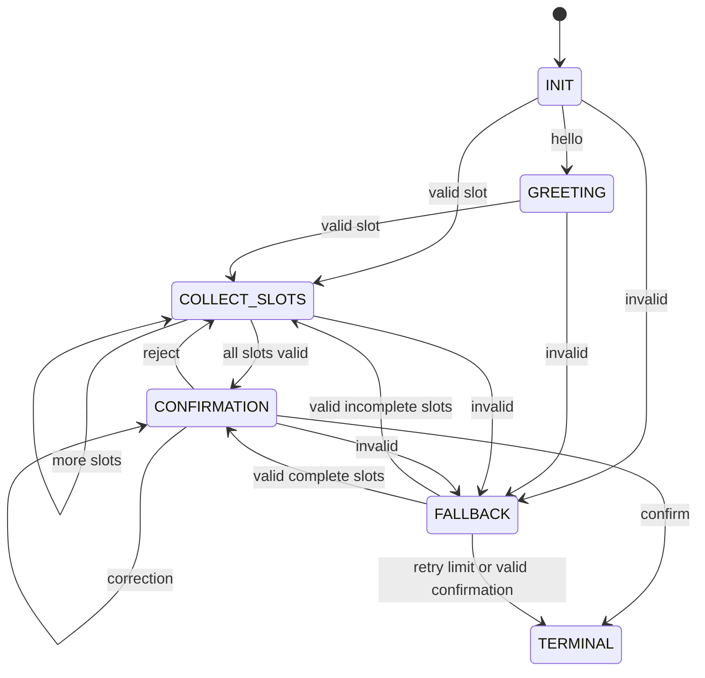

# FST and noisy-channel protocol

## Controller
`FSTDialogueManager` in `fst_manager.py` separates deterministic navigation control from channel corruption. Its states are INIT, GREETING, COLLECT_SLOTS, CONFIRMATION, TERMINAL and FALLBACK. The assignment's final TERMINAL / FALLBACK entry is represented by two explicit states. An optional greeting passes INIT to GREETING; valid slot data can also start collection directly.

`slot_memory = {}` stores destination, speed and clearance_code. Regex extraction accepts Sirius, Orion Arm or Alpha Centauri; warp/speed values 0.1 through 9.9 in steps of 0.1; and the demonstration code ALPHA-7. Values can arrive in any order. Conflicting destination/speed values, invalid clearance and recognized negation/override patterns enter FALLBACK. A valid slot recovers from fallback. Three consecutive invalid turns abort to TERMINAL. A complete slot set enters CONFIRMATION; a separate yes/confirm authorizes. Corrections require reconfirmation; no clears slots; cancel aborts. TERMINAL is absorbing.

The dialogue is a Mealy-style finite controller with a bounded memory buffer. Its full formal state includes the control label, finite slot domains, retry counter and authorization flag. INIT is q0; only authorized TERMINAL configurations accept navigation. Aborted TERMINAL configurations close without accepting. Input alphabet consists of parsed intent/value tags; output alphabet consists of prompts and summaries. No Python eval, shell execution or LLM interpretation is used.

## Wire protocol
One turn means one speaker message: five exchanges produce exactly ten turns. A word is a whitespace-separated token, including the substituted noise word. Each wire message contains at most seven words. All ten messages have one actual token substitution from {Banana, Labyrinth, Quantum, Midnight, Velocity, Green, Cosmological}; the noise is not merely appended outside the limit.

For one- or two-word payloads, each word is transmitted three times. A uniformly sampled position is replaced with a uniformly sampled noise word. The decoder recognizes the reserved noise vocabulary, treats it as an erasure and recovers a word from surviving copies. Shared assumptions are packet alignment, known repetition grouping and a reserved noise alphabet. A fully erased group becomes [ERASURE], never a guessed command. Longer payloads remain within seven words but receive no repetition; this limitation is explicit.

The confirmation summary uses `destination/speed/code` as one whitespace token. This compact notation requires a shared schema; its longer character count shows why a word budget is not a fixed bit budget. No physical command is sent: authorization is only a simulated flag. The ten-turn run starts directly with a destination and ends with a status request after authorization; greeting and reset paths are tested separately.
